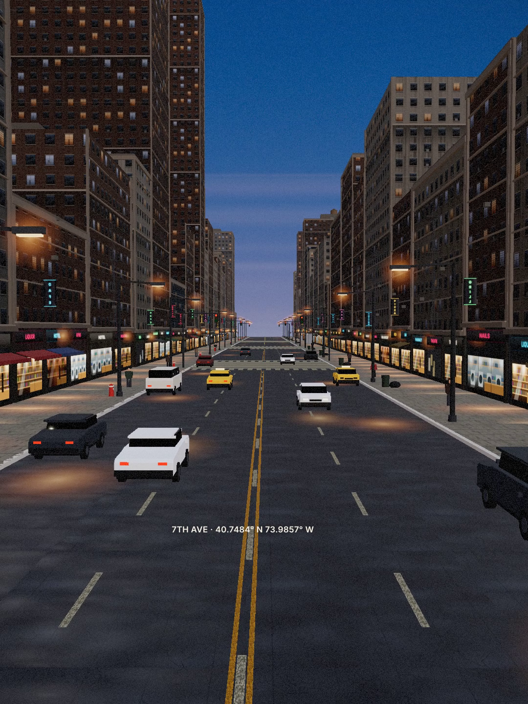

# Dusk Avenue — a Manhattan avenue at blue hour, vertical

A 6-second cinematic shot of a New York avenue at dusk, built entirely in code
with three.js + Remotion. **No imported models, no downloaded textures**: every
surface is a canvas texture drawn at runtime, every object is procedural geometry.

| | |
|---|---|
| Composition | `dusk-avenue-3x4` |
| Format | 1080 × 1440 (3:4 portrait), 24 fps, 144 frames (6 s) |
| Lens | 35 mm, camera hung at 5.6 m over the roadway |
| Move | one dolly, 15 m up the avenue |
| Master | `out/dusk-avenue-3x4.mp4` |
| Seed | `23` (deterministic) |



## What is in the frame

The camera hangs over the centre of an 18.4 m avenue with 7.2 m sidewalks, 16.6 m
from each building line, and drifts 15 m north while a peach afterglow sits on the
vanishing point.

- **Sky** — a single canvas gradient from navy zenith to peach at the horizon,
  painted on a back-side sphere; a soft additive afterglow plane sits at the end of
  the avenue, and a matched fog colour ties the far towers into the haze.
- **Ground floor** — every lot has a lit storefront: a canvas-drawn interior
  (grocery shelves, bar back-bar, laundromat drums, café counter, roll-down gate),
  bevelled glass, a mullion grid, an illuminated fascia sign, an awning, and a
  hanging blade sign perpendicular to the wall.
- **Upper floors** — 2048² facade textures over **8 window bays × 7 floors**:
  brick courses with per-brick tone variation, ashlar joints, curtain-wall
  spandrels, deep window reveals, sash bars, sills with drip stains, AC units,
  soot under the cornice, rain streaks, ~26 % lit rooms. A derived canvas is used as
  a **bump map** so sills and lintels catch the light.
- **Street** — asphalt drawn as fine aggregate, hairline cracks, patch mottling and
  longitudinal seams (no large repeating features, so the tiling never lattices);
  a low-contrast roughness map; concrete sidewalk slabs with joints, gum and
  stains; kerbs, crisp white lane dashes, a **separate yellow double centre line**,
  crosswalks and stop lines at three cross streets.
- **Traffic** — cars are **extruded silhouettes**: a lower body profile extruded
  across the width (bonnet, flanks, boot), a narrower glass greenhouse on the
  beltline, a body-coloured roof panel and pillars, wheel arches, bumpers, mirrors,
  headlight and tail-light emitters, and a roof sign on the taxis.
- **Light** — a dim 3100 K key (the sun is already down), a 16 000 K sky fill so the
  canyon falls into cool shade, warm ground bounce, four sodium practicals, lit
  windows and storefronts that bloom. Lamp pools, headlight pools and glow sprites
  are additive quads on the asphalt.
- **Film pass** — ACES, exposure 1.18, bloom 0.3, halation 0.26, grain, vignette,
  and a deep-focus camera (60 m at f/11) so the whole avenue stays sharp.

## Why the previous look was rejected, and what fixed it

- Box-on-box cars read as white slabs → extruded body + separate glass greenhouse.
- A wet, mirror-like road blew out into a glare streak down the centre → matte
  roughness map, no mirror puddles, dry asphalt.
- Broad warm "sheen" washes made the road look like dirt → removed the extra warm
  directional light; the road is lit by sky fill only, with compact lamp pools.
- Flat pastel facades → 8 × 7 window bays per tile and intrinsically darker masonry
  palettes.
- Everything soft → focus moved from 16 m to 60 m and the aperture stopped to f/11.

## Files

```
dusk-avenue/
├── src/shot/Shot.tsx      the whole shot: textures, geometry, light, camera
├── src/shot.config.ts     name, format (3:4), seed
├── src/Root.tsx           Remotion composition registration (adds the 3:4 format)
├── tools/probe.mjs        single-frame look development
└── review/                stills, contact sheet, stats (git-ignored)
```

## Rendering

```bash
../tools/setup-toolchain.sh          # ffmpeg + headless chromium, once
export CINE_BROWSER=~/cine-browser/chrome-wrap CINE_GL=swangle
export LD_LIBRARY_PATH=~/cine-browser/lib

SKILL=~/.claude/skills/cinematic-3d
node $SKILL/scripts/stills.mjs                    # 5-frame gate + review/contact.png
node $SKILL/scripts/render.mjs --final --comp dusk-avenue-3x4
```

`render.mjs` defaults to a 9:16 comp because its format table predates 3:4, so the
composition has to be passed explicitly with `--comp`.

## Performance notes

Repeating detail — window ledges, fire escapes, signs, hydrants, cars, pedestrians —
is baked into three merged vertex-coloured meshes (opaque, glass, emissive). On this
2-vCPU box with SwiftShader the shot renders at roughly 6–7 s/frame at 1080 × 1440.
